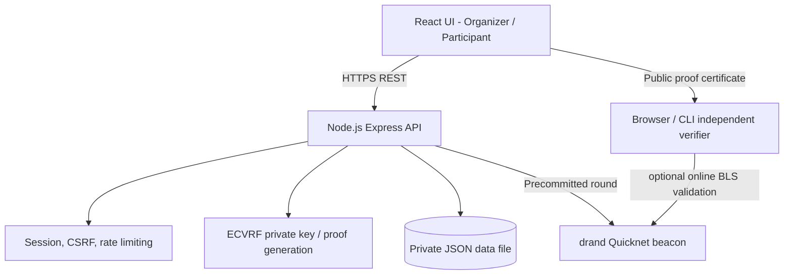
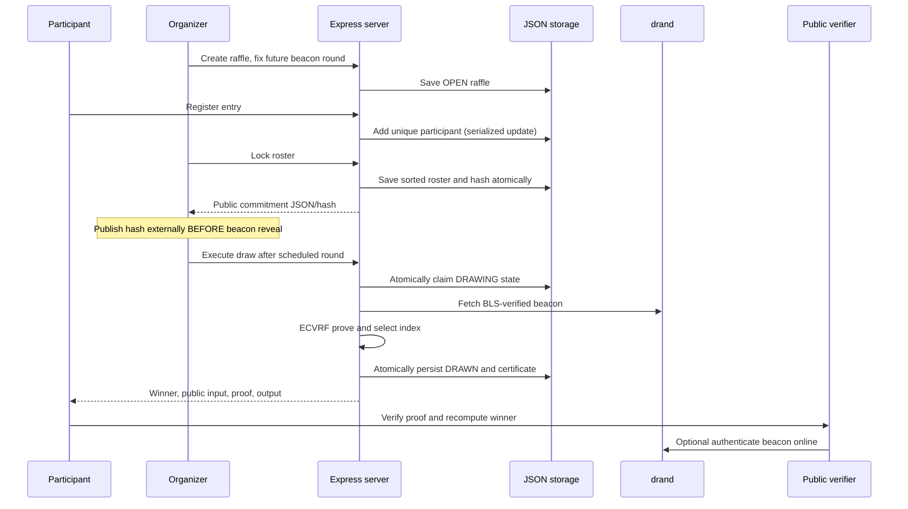

# Architecture and data flow - JSON storage edition

The frontend cannot access the ECVRF private key. The backend reads the secret from `backend/.env` (or managed secrets). It stores sessions, participants, commitments, key metadata, results and audit events in `backend/data/veridraw.json`.

## Registration to draw sequence

## Storage rules and trust model

- JSON file operations are serialized through a single backend-process write queue. Mutations use clone-then-write and same-directory atomic replacement. Errors do not publish partial in-memory mutations.
- **Single Node process** only. Parallel Node instances or external writers may overwrite each other. Do not edit the file while the server is running.
- The file must be private and stored on a durable disk. At rest it is not encrypted by this project; filesystem controls and backups matter.
- Key rotation uses stable public-key metadata; revocation prevents new draws using that key, while historical public proofs stay verifiable.
- External timestamped commitment publication is necessary for stronger fairness; server-side times alone do not prove early locking.
